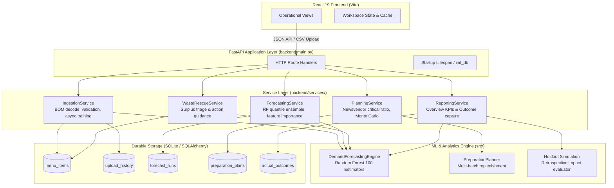

# WasteWise AI — System Architecture & Data Flow

## 1. Executive Summary

WasteWise AI is an enterprise FoodTech demand forecasting and batch preparation intelligence system built for the **ADAPPT 5.0 — AI in FoodTech** showcase. The system replaces static, rule-of-thumb kitchen cooking with an explainable Machine Learning ensemble (Random Forest quantile regression) and stochastic Newsvendor batch optimization.

The platform is designed around strict operational principles:
- **Zero Calculation Drift**: The core demonstration baseline metrics ($161$ portions demand, $168$ recommended prep, $7$ surplus portions, $₹887$ naive cost at risk, $8.4\%$ holdout WAPE) remain mathematically identical across server restarts and upgrades.
- **Service-Layer Separation**: All business logic, machine learning pipelines, and optimization math reside in dedicated service classes, decoupled from HTTP endpoints.
- **Durable Persistence**: SQLite with Write-Ahead Logging (WAL) guarantees transactional durability for menu items, upload history, forecast runs, preparation plans, and measured kitchen outcomes.
- **Non-Blocking Concurrency**: Heavy model retraining runs off the main event loop in thread workers guarded by async mutex locks.



---

## 2. State Boundaries & Persistence Architecture

The application balances high-speed in-memory analytics with durable SQLite persistence.

| Component | Storage Mechanism | Lifetime | Description |
| :--- | :--- | :--- | :--- |
| **Active Dataset** | `AppState.dataset_df` (Pandas) | Process memory | Active 180-day demonstration or operator dataset for instant analytical queries. |
| **Model Artifacts** | `AppState.engine` (Scikit-Learn) | Process memory | Fitted Random Forest estimators, baseline matrices, and evaluation holdout records. |
| **Menu Catalog** | `menu_items` (SQLite) | Durable disk | Active dishes, standard categories, portion ingredient costs, selling prices, and batch sizes. |
| **Upload Audit** | `upload_history` (SQLite) | Durable disk | SHA256 file hashes, row counts, service days, and validation warnings for audit provenance. |
| **Forecast Runs** | `forecast_runs` (SQLite) | Durable disk | Scenario inputs (attendance, weather, campus event), predicted demands, bounds, and feature weights. |
| **Preparation Plans** | `preparation_plans` (SQLite) | Durable disk | Recommended batch sizes, refill triggers, and critical ratios per meal service. |
| **Actual Outcomes** | `actual_outcomes` (SQLite) | Durable disk | Measured portions cooked, sold, leftover, kilograms discarded, and food donated. |

### SQLite Database Configuration
- **Database Engine**: SQLite 3.50+ managed via SQLAlchemy 2.0.
- **Connection Mode**: `check_same_thread=False` with connection pooling.
- **Pragmas**:
  - `PRAGMA journal_mode=WAL`: Concurrent reads do not block writes.
  - `PRAGMA foreign_keys=ON`: Relational integrity between catalog and plans.
  - `PRAGMA synchronous=NORMAL`: Balances flash storage durability with high transaction throughput.

---

## 3. SQLite Relational Schema

### A. `menu_items`
```sql
CREATE TABLE menu_items (
    id INTEGER PRIMARY KEY AUTOINCREMENT,
    name VARCHAR(100) NOT NULL UNIQUE,
    category VARCHAR(50) NOT NULL,
    cost_price FLOAT NOT NULL,
    selling_price FLOAT NOT NULL,
    prep_time_min INTEGER DEFAULT 30,
    prep_batch_size INTEGER DEFAULT 20,
    shelf_life_hours FLOAT DEFAULT 4.0,
    base_demand FLOAT DEFAULT 50.0,
    active BOOLEAN DEFAULT 1,
    created_at DATETIME DEFAULT (CURRENT_TIMESTAMP),
    updated_at DATETIME DEFAULT (CURRENT_TIMESTAMP)
);
CREATE INDEX ix_menu_items_name ON menu_items (name);
CREATE INDEX ix_menu_items_category ON menu_items (category);
```

### B. `upload_history`
```sql
CREATE TABLE upload_history (
    id INTEGER PRIMARY KEY AUTOINCREMENT,
    filename VARCHAR(255) NOT NULL,
    checksum VARCHAR(64) NOT NULL,
    row_count INTEGER NOT NULL,
    service_days INTEGER DEFAULT 0,
    validation_warnings_json TEXT DEFAULT '[]',
    timestamp DATETIME DEFAULT (CURRENT_TIMESTAMP),
    source VARCHAR(30) DEFAULT 'operator',
    is_active BOOLEAN DEFAULT 1
);
CREATE INDEX ix_upload_history_checksum ON upload_history (checksum);
CREATE INDEX ix_upload_history_timestamp ON upload_history (timestamp);
```

### C. `forecast_runs`
```sql
CREATE TABLE forecast_runs (
    id INTEGER PRIMARY KEY AUTOINCREMENT,
    timestamp DATETIME DEFAULT (CURRENT_TIMESTAMP),
    menu_item VARCHAR(100) NOT NULL,
    day_of_week VARCHAR(20) NOT NULL,
    attendance_index FLOAT NOT NULL,
    is_event INTEGER NOT NULL,
    weather VARCHAR(50) NOT NULL,
    target_service VARCHAR(50) DEFAULT 'Lunch',
    predicted_demand FLOAT NOT NULL,
    lower_bound FLOAT NOT NULL,
    upper_bound FLOAT NOT NULL,
    weekday_baseline FLOAT DEFAULT 0.0,
    model_version VARCHAR(50) DEFAULT '1.0-rf',
    feature_contributions_json TEXT DEFAULT '{}'
);
CREATE INDEX ix_forecast_runs_menu_item ON forecast_runs (menu_item);
CREATE INDEX ix_forecast_runs_timestamp ON forecast_runs (timestamp);
```

### D. `preparation_plans`
```sql
CREATE TABLE preparation_plans (
    id INTEGER PRIMARY KEY AUTOINCREMENT,
    service_date VARCHAR(20) NOT NULL,
    target_meal VARCHAR(50) DEFAULT 'Lunch',
    menu_item VARCHAR(100) NOT NULL,
    predicted_demand FLOAT NOT NULL,
    lower_bound FLOAT NOT NULL,
    upper_bound FLOAT NOT NULL,
    current_stock INTEGER DEFAULT 0,
    critical_ratio FLOAT DEFAULT 0.55,
    recommended_total_plan INTEGER NOT NULL,
    recommended_initial_batch INTEGER NOT NULL,
    refill_trigger_threshold INTEGER DEFAULT 0,
    wastewise_expected_cost FLOAT DEFAULT 0.0,
    current_policy_expected_cost FLOAT DEFAULT 0.0,
    net_cost_avoided FLOAT DEFAULT 0.0,
    status VARCHAR(30) DEFAULT 'recommended',
    created_at DATETIME DEFAULT (CURRENT_TIMESTAMP)
);
CREATE INDEX ix_preparation_plans_service_date ON preparation_plans (service_date);
CREATE INDEX ix_preparation_plans_menu_item ON preparation_plans (menu_item);
```

### E. `actual_outcomes`
```sql
CREATE TABLE actual_outcomes (
    id INTEGER PRIMARY KEY AUTOINCREMENT,
    service_date VARCHAR(20) NOT NULL,
    target_meal VARCHAR(50) DEFAULT 'Lunch',
    menu_item VARCHAR(100) NOT NULL,
    portions_prepared INTEGER NOT NULL,
    portions_sold INTEGER NOT NULL,
    portions_leftover INTEGER NOT NULL,
    discarded_kg FLOAT DEFAULT 0.0,
    donation_kg FLOAT DEFAULT 0.0,
    waste_cost FLOAT DEFAULT 0.0,
    notes TEXT DEFAULT '',
    recorded_at DATETIME DEFAULT (CURRENT_TIMESTAMP)
);
CREATE INDEX ix_actual_outcomes_service_date ON actual_outcomes (service_date);
CREATE INDEX ix_actual_outcomes_menu_item ON actual_outcomes (menu_item);
```

---

## 4. Service Layer Responsibilities

### `backend/services/forecasting_service.py`
- Executes point demand predictions and ensemble quantile intervals ($10\text{th}$ and $90\text{th}$ percentiles).
- Extracts real tree-derived feature importances directly from `model.feature_importances_`.
- Assembles historical trajectory curves for the preceding 30 service records.
- Persists scenario runs into `forecast_runs`.

### `backend/services/planning_service.py`
- Implements the Newsvendor stochastic order quantity model:
  $$CR = \frac{C_{\text{shortage}}}{C_{\text{shortage}} + C_{\text{surplus}}}$$
- Evaluates existing batch stock to calculate net portions to prepare.
- Computes multi-batch replenishment splitting ($65\%$ initial batch, remainder staged with trigger thresholds).
- Generates 600-point Monte Carlo Gaussian distributions for frontend risk visualization.
- Persists plans into `preparation_plans`.

### `backend/services/ingestion_service.py`
- Handles BOM and UTF-8/UTF-8-SIG byte stream normalization.
- Validates structural schema, positive integer bounds, and required columns (`date`, `portions_sold`, `attendance_index`, `campus_event`, `weather`, `cost_per_portion`, `selling_price`).
- Guards upload ingestion with an async mutex lock (`asyncio.Lock()`) to prevent concurrent model collisions.
- Executes CPU-bound training asynchronously via `await asyncio.to_thread(engine.train_and_evaluate, ...)`.
- Computes SHA256 checksums, logs upload history, and dynamically registers newly discovered dishes into `menu_items`.

### `backend/services/rescue_service.py`
- Analyzes disparity between planned preparation and expected demand.
- Categorizes surplus risk into High ($\ge 15\%$ surplus and $\ge ₹300$ exposure), Moderate, and Low tiers.
- Formulates specific operational guidance (e.g. batch hold, dynamic pricing, staff meal donation).

### `backend/services/reporting_service.py`
- Dynamically aggregates kitchen overview KPIs across active dishes.
- Evaluates holdout test splits against traditional moving-average baselines.
- Provides CRUD capabilities for actual service outcomes (`actual_outcomes`).

---

## 5. Concurrency, Thread Safety & Error Recovery

1. **Async Event Loop Isolation**:
   FastAPI's main thread runs non-blocking async I/O. Intensive CPU operations (Random Forest training with 100 estimators across multiple threads) are offloaded to Python's background thread pool via `asyncio.to_thread`.
2. **Upload Mutex**:
   `IngestionService._lock = asyncio.Lock()` ensures that only one dataset ingestion/training cycle executes at any given moment. Concurrent uploads receive a clean queued or rejected response without corrupting in-memory state.
3. **Transaction Rollback**:
   All database writes use scoped sessions (`get_db_context()`) with explicit commits and context-managed cleanup.
4. **Validation Isolation**:
   If an uploaded CSV fails schema validation or model fitting, the error is returned immediately with status 422, leaving `AppState.engine`, `AppState.dataset_df`, and SQLite tables completely unchanged.
