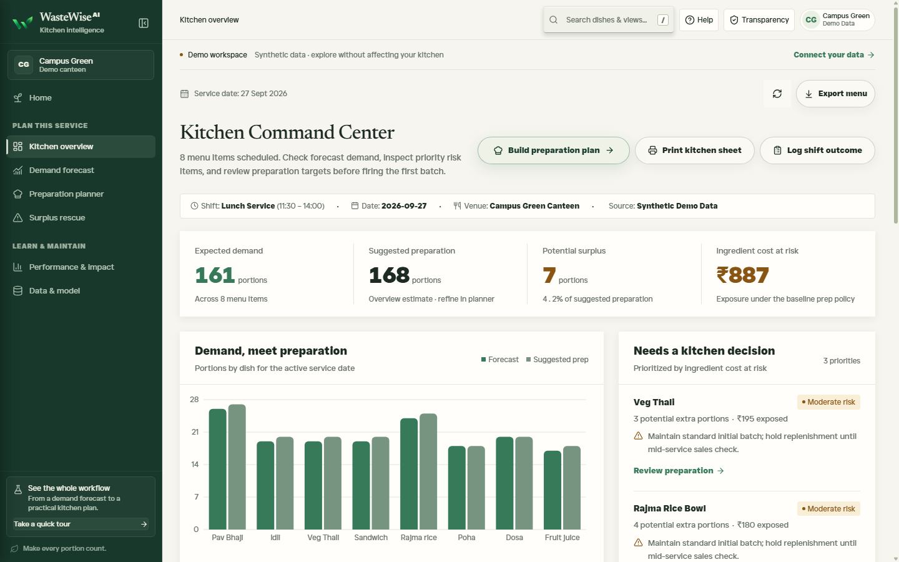
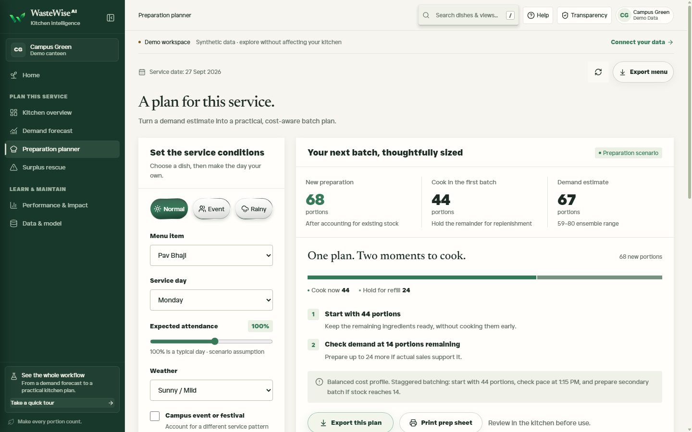
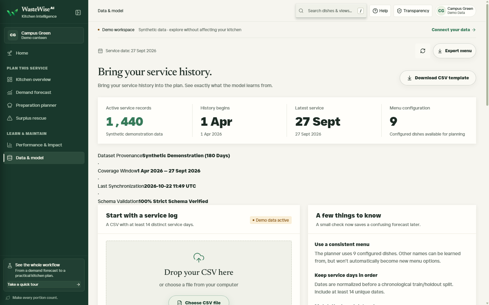

# WasteWise AI — Intelligent Canteen Demand Forecasting & Food-Waste Reduction

[](https://www.python.org/)
[](https://fastapi.tiangolo.com/)
[](https://react.dev/)
[](https://www.typescriptlang.org/)
[](https://vite.dev/)
[](https://www.sqlite.org/)
[](#)

> **Predict smarter. Prepare better. Waste less.**  
> An enterprise-grade canteen operational intelligence platform that connects machine-learning demand forecasting with asymmetric Newsvendor batch preparation planning, proactive surplus triage, and permanent shift outcome logging.

---

## Table of Contents

- [Overview](#overview)
- [Screenshots](#screenshots)
- [Core Features](#core-features)
- [How It Works](#how-it-works)
- [Technology Stack & Architecture](#technology-stack--architecture)
- [Project Layout](#project-layout)
- [Local Installation & Setup](#local-installation--setup)
- [Operator Usage Guide](#operator-usage-guide)
- [API & Data Persistence](#api--data-persistence)
- [Model Evaluation & Data Integrity](#model-evaluation--data-integrity)
- [Testing & Quality Assurance](#testing--quality-assurance)
- [Project Status & Operational Limitations](#project-status--operational-limitations)
- [Academic Context & Credits](#academic-context--credits)

---

## Overview

In commercial kitchens, university dining halls, and corporate canteens, food-service managers face an asymmetric daily dilemma: **cook too much and ingredients spoil into organic waste; cook too little and customers encounter stockouts and missed revenue**. Traditional fixed-batch cooking relies on gut feeling, resulting in 15–25% avoidable surplus and margin erosion.

**WasteWise AI** transforms this operational workflow into a calm, evidence-based decision system:
1. **Calibrated Demand Estimates**: Leverages historical dish sales, calendar signals, campus events, and weather indicators to generate point forecasts and empirical uncertainty spreads.
2. **Asymmetric Preparation Sizing (Newsvendor Optimization)**: Computes optimal batch cooking targets by balancing ingredient spoilage costs against customer stockout penalties.
3. **Staggered Two-Phase Batch Production**: Recommends firing a conservative initial buffer (e.g. 60–65%) while holding mise-en-place for mid-service replenishment triggers.
4. **Proactive Surplus Rescue**: Identifies dishes with high surplus exposure hours before service ends, enabling discounted sales or food NGO donations.
5. **Persistent Operational Auditing**: Permanently logs physical shift outcomes (prepared, sold, leftovers, and waste causes) into SQLite for accountability and model retraining.

---

## Screenshots

### Home & Operational Command Stage

*Figure 1: Desktop Home viewport (1440×900) featuring editorial value proposition, responsive telemetry HUD console, today's operating cadence timeline, and live reference benchmark KPIs.*

### Mobile Experience
<p align="center">
  
</p>
*Figure 2: Mobile viewport (390×844) showing full tactile layout stability, single-column cadence flow, and zero horizontal overflow (`scrollWidth - clientWidth === 0`).*

### Kitchen Command Center (Overview)

*Figure 3: Kitchen Command Center with live shift KPIs (161 expected demand, 168 suggested prep, 7 potential surplus, ₹887 cost-at-risk), menu portion distribution, and prioritized risk decision cards.*

### Demand Forecasting & Uncertainty Bounds

*Figure 4: Single-dish demand forecasting view demonstrating condition presets (Normal, Event, Rainy), calendar sliders, 10th–90th tree prediction ranges, and historical sales trends.*

### Preparation Planner & Staggered Batching

*Figure 5: Intelligent two-phase batch production planner with inventory-aware stock deduction, refill triggers, and printable physical kitchen preparation sheets.*

### Surplus Rescue & Triage Queue

*Figure 6: Proactive surplus triage queue categorizing dishes into High, Moderate, and Low risk with actionable kitchen interventions and physical outcome logging.*

### Model Performance & Holdout Evaluation

*Figure 7: Transparent retrospective evaluation on 280 unseen holdout service records comparing the model (8.4% WAPE, 4.8 portion MAE) against historical weekday baselines.*

### Data Management & Model Provenance

*Figure 8: Dataset ingestion interface showing active service records, schema validation audit, provenance disclosures, and CSV upload dropzone.*

---

## Core Features

### 1. Demand Forecasting with Probabilistic Spread
- **Supervised Random Forest Pipeline**: Trains on historical portion consumption across menu items, parameterized by day-of-week, campus attendance ratio, weather conditions, temperature, and scheduled exam/event flags.
- **Uncertainty Interval**: Computes the 10th–90th percentile prediction interval across the decision tree ensemble to transparently convey forecast variance to operators.
- **Interactive Scenario Simulation**: Allows managers to dynamically simulate rainstorms, attendance surges, or campus festivals and observe updated demand distributions in real time.

### 2. Economic Preparation Planning (Newsvendor Model)
- **Asymmetric Cost Balancing**: Calculates the critical fractile $CF = \frac{C_u}{C_u + C_o}$ where $C_u$ represents the underage cost (missed margin / diner dissatisfaction) and $C_o$ represents the overage cost (ingredient spoilage).
- **Inventory-Aware Sizing**: Automatically accounts for existing ready-to-serve inventory, subtracting current stock from new batch targets.
- **Two-Phase Staggered Production**: Calculates the initial prep volume (Batch 1, typically 60–65%) and determines precise replenishment triggers (e.g. *"fire Batch 2 if remaining stock reaches ≤5 portions before 1:15 PM"*).
- **Printable Kitchen Preparation Sheet**: Generates clipboard-ready, print-optimized production sheets complete with holding temperature targets (>65°C), refill checkpoints, and supervisor sign-off lines.

### 3. Surplus Triage & Rescue Protocol
- **Financial Risk Exposure**: Quantifies potential monetary losses based on unit ingredient cost multiplied by anticipated leftover portions.
- **Risk Categorization**: Automatically triages menu items into **High Risk**, **Moderate Risk**, and **Low Risk** queues.
- **Actionable Kitchen Interventions**: Recommends practical culinary actions such as holding raw mise-en-place, routing surplus to campus cafeterias, or scheduling verified donation pickups.

### 4. Operational Outcome Logging & Audit Trail
- **Strict Data Validation**: Validates operator shift logs enforcing the operational invariant:
  $$\text{portions\_prepared} = \text{portions\_sold} + \text{portions\_leftover}$$
- **Root-Cause Taxonomy**: Categorizes surplus causes into standardized operational codes: `overproduction`, `spoilage`, `quality_issue`, or `equipment_failure`.
- **Persistent SQLite Storage**: Records shift logs in `actual_outcomes` table with non-destructive schema migrations and audit timestamps.

### 5. Kitchen Accessibility & Ergonomics
- **Dual-State Collapsible Navigation Rail**: Supports expanded 260px desktop navigation, 72px icon rail with hover tooltips, and mobile slide-in drawer with backdrop blur. Retains user preference across sessions via `localStorage`.
- **Keyboard Shortcuts & Quick Search**: Press `⌘K` or `/` to trigger the fast fuzzy search modal across views and dishes. Press `?` for help.
- **Zero Horizontal Overflow**: Guaranteed 0px layout overflow (`scrollWidth - clientWidth === 0`) across mobile (390px), tablet (768px), laptop (1366px), and desktop (1440px+).

---

## How It Works

```
┌────────────────────────────────────────────────────────────────────────┐
│                        1. Operational Ingestion                         │
│  Historical sales logs (CSV) + Campus Calendar + Service Day Context    │
└───────────────────────────────────┬────────────────────────────────────┘
                                    │
                                    ▼
┌────────────────────────────────────────────────────────────────────────┐
│                       2. Demand Forecasting                             │
│   Random Forest Regressor ──► Point Estimate + 80% Uncertainty Band    │
└───────────────────────────────────┬────────────────────────────────────┘
                                    │
                                    ▼
┌────────────────────────────────────────────────────────────────────────┐
│                      3. Preparation Optimization                        │
│   Newsvendor Loss Balancing ──► Batch 1 Target + Refill Thresholds     │
└───────────────────────────────────┬────────────────────────────────────┘
                                    │
                                    ▼
┌────────────────────────────────────────────────────────────────────────┐
│                        4. Kitchen Execution                             │
│    Printable Prep Sheet ──► Food-Safe Holding ──► Mid-Shift Check      │
└───────────────────────────────────┬────────────────────────────────────┘
                                    │
                                    ▼
┌────────────────────────────────────────────────────────────────────────┐
│                    5. Surplus Triage & Outcome Audit                    │
│    Surplus Rescue Routing ──► Shift Outcome Logging (SQLite)           │
└────────────────────────────────────────────────────────────────────────┘
```

1. **Ingestion & Validation**: The platform loads service records (default 180-day demonstration dataset or operator-uploaded CSV) validating schema integrity, date continuity, and dish naming.
2. **Model Training**: A `RandomForestRegressor` ensemble is fitted on historical portion sales with engineered calendar and situational features.
3. **Plan Formulation**: Demand distributions are passed to the `PreparationPlanner`, applying unit ingredient costs and shortage penalties to determine optimal production targets.
4. **Kitchen Operations**: Kitchen crews use the printable preparation sheet to cook the initial buffer, monitor holding temperatures, and trigger batch refills only when needed.
5. **Shift Review**: At shift conclusion, supervisors log actual portions prepared, sold, and remaining, recording specific waste causes to build an empirical audit trail for continuous model improvement.

---

## Technology Stack & Architecture

### Frontend Architecture
- **Framework**: [React 19](https://react.dev/) with [TypeScript 5.9](https://www.typescriptlang.org/)
- **Build Tooling**: [Vite 8](https://vite.dev/) (lightning-fast HMR and production bundling)
- **Styling**: [Tailwind CSS v4](https://tailwindcss.com/) paired with CSS Variables design token architecture (`tokens.ts` & `index.css`)
- **Icons**: [Lucide React](https://lucide.dev/)
- **Motion**: [Framer Motion 14](https://www.framer.com/motion/) with strict `prefers-reduced-motion` compliance
- **Typography**: Self-hosted Newsreader (editorial serif), Source Sans 3 (interface sans), and Just Sans (display)

### Backend & Machine Learning
- **API Framework**: [FastAPI](https://fastapi.tiangolo.com/) with [Pydantic v2](https://docs.pydantic.dev/) schemas
- **ASGI Server**: [Uvicorn](https://www.uvicorn.org/)
- **Persistence**: [SQLAlchemy 2.0](https://www.sqlalchemy.org/) with [SQLite](https://www.sqlite.org/)
- **Machine Learning**: [scikit-learn](https://scikit-learn.org/) (`RandomForestRegressor`), [pandas](https://pandas.pydata.org/), [numpy](https://numpy.org/)

---

## Project Layout

```text
wastewise-ai/
├── backend/                        # FastAPI application & persistence layer
│   ├── database.py                 # SQLite engine, sessions & additive schema migrations
│   ├── main.py                     # API routing, CORS, lifespans & frontend static mounting
│   ├── models.py                   # SQLAlchemy persistent database models
│   └── services/                   # Decoupled service architecture
│       ├── forecasting_service.py  # Demand inference & uncertainty intervals
│       ├── ingestion_service.py    # CSV validation, sanitization & retraining
│       ├── planning_service.py     # Newsvendor batch planning & prep sheet data
│       ├── reporting_service.py    # Holdout performance & simulated impact metrics
│       └── rescue_service.py       # Surplus risk triage & routing protocols
├── data/                           # Data storage & baseline records
│   ├── active_operator_dataset.csv # Currently active operator dataset
│   ├── wastewise.db                # SQLite database (auto-generated at runtime)
│   └── wastewise_sample_canteen_data.csv # 180-day demonstration records
├── docs/                           # Documentation assets
│   └── screenshots/                # Verified high-resolution application screenshots
├── frontend/                       # React TypeScript single-page application
│   ├── public/                     # Static assets, self-hosted fonts & brand mark
│   ├── src/
│   │   ├── api.ts                  # Typed client fetch abstractions & timeout guards
│   │   ├── App.tsx                 # Application shell, layout router & header utilities
│   │   ├── Sidebar.tsx             # Collapsible desktop rail & mobile drawer
│   │   ├── MetalButton.tsx         # Tactile metallic button component
│   │   ├── tokens.ts               # Design system color and spatial tokens
│   │   ├── index.css               # Design system rules, responsive queries & print styles
│   │   └── workspace/              # Operational view modules
│   │       ├── Home.tsx            # Hero landing stage & telemetry HUD console
│   │       ├── Overview.tsx        # Kitchen Command Center dashboard
│   │       ├── Scenario.tsx        # Demand forecasting & batch preparation planner
│   │       ├── Rescue.tsx          # Surplus risk triage & triage queue
│   │       ├── Performance.tsx     # Historical holdout model evaluation
│   │       ├── Data.tsx            # Data ingestion, schema validation & dataset management
│   │       ├── PrintKitchenSheet.tsx # Clipboard-ready printable kitchen sheet dialog
│   │       ├── QuickSearchDialog.tsx # Global ⌘K fuzzy navigation dialog
│   │       └── OutcomeLogger.tsx   # Physical shift outcome logging component
│   └── vite.config.ts              # Vite bundling & local API proxy configuration
├── src/                            # Core Python forecasting & planning library
│   ├── config.py                   # Default canteen constants, menus & hyperparameters
│   ├── data.py                     # Synthetic data generator & CSV validator
│   ├── metrics.py                  # Evaluation calculations (WAPE, MAE) & impact simulator
│   ├── model.py                    # DemandForecastingEngine (Random Forest)
│   └── planner.py                  # PreparationPlanner (Newsvendor optimization)
├── tests/                          # Automated test suite (pytest)
│   ├── test_api.py                 # FastAPI endpoint status & schema tests
│   ├── test_data.py                # Dataset validation & CSV ingestion tests
│   ├── test_database.py            # SQLite schema migrations & CRUD persistence tests
│   ├── test_metrics.py             # Evaluation & financial exposure calculation tests
│   ├── test_model.py               # Model fitting & prediction interval tests
│   ├── test_planner.py             # Batch sizing & Newsvendor constraint tests
│   └── test_tokens.py              # Strict color token parity tests
├── run_website.bat                 # One-click Windows batch launcher
├── run_website.ps1                 # One-click Windows PowerShell launcher
└── requirements.txt                # Python backend dependencies
```

---

## Local Installation & Setup

### Prerequisites
- **Python**: Version 3.10, 3.11, 3.12, 3.13, or 3.14.
- **Node.js & npm**: Node.js v20.0+ (Node v22 or v24 recommended) with npm.

### Quick Start (Automated One-Click)

#### Windows PowerShell:
```powershell
.\run_website.ps1
```

#### Windows Command Prompt (Batch):
```cmd
run_website.bat
```

The script automatically builds the React frontend production bundle and starts the unified FastAPI server. Open your browser to:
👉 **[http://127.0.0.1:8000](http://127.0.0.1:8000)**

---

### Manual Step-by-Step Installation

If you prefer to configure the backend and frontend separately:

#### 1. Clone the Repository
```bash
git clone https://github.com/TanishBane/wastewise-ai.git
cd wastewise-ai
```

#### 2. Backend Setup
Create and activate a Python virtual environment:
```powershell
# Windows
python -m venv .venv
.\.venv\Scripts\Activate.ps1

# Linux / macOS
python3 -m venv .venv
source .venv/bin/activate
```

Install Python dependencies:
```bash
pip install -r requirements.txt
```

#### 3. Build Frontend
Install npm dependencies and compile the production bundle:
```bash
cd frontend
npm install
npm run build
cd ..
```

#### 4. Launch the Server
```bash
python -m uvicorn backend.main:app --host 127.0.0.1 --port 8000
```
FastAPI serves both the compiled React single-page application and all `/api` endpoints from the same origin on port `8000`.

---

### Development Mode with Live Hot-Reloading (HMR)

For active frontend development:
1. Start the FastAPI backend on port 8000:
   ```bash
   python -m uvicorn backend.main:app --host 127.0.0.1 --port 8000 --reload
   ```
2. In a second terminal, start the Vite development server:
   ```bash
   cd frontend
   npm run dev
   ```
3. Open `http://localhost:3000`. Vite automatically proxies all `/api` calls to the FastAPI backend at `http://127.0.0.1:8000`.

---

## Operator Usage Guide

A recommended standard operating cadence for kitchen supervisors:

1. **Morning Signal Review (06:30 – 07:00)**:
   - Open **Kitchen Command Center** (`#overview`).
   - Check expected footfall, weather conditions, and overall planned portions.
   - Review high-risk alerts flagging menu items with volatile demand.
2. **Batch Planning & Kitchen Printout (07:00 – 08:00)**:
   - Navigate to **Preparation Planner** (`#prep-planner`).
   - Enter existing ready-to-serve inventory from yesterday's service.
   - Click **Print kitchen sheet** to print the physical clipboard sheet with Batch 1 targets, refill triggers, and holding temperature check lines.
3. **Mid-Service Refill Check (12:30 – 13:00)**:
   - Compare physical remaining stock against the designated refill trigger (e.g. `<5 portions remaining`).
   - Commit Batch 2 to the kettles only if demand velocity warrants it.
4. **Surplus Triage & Rescue (13:45 – 14:15)**:
   - Open **Surplus Rescue** (`#waste-risk`).
   - Identify dishes with excess portions. Mark portions for discount flash sales or campus food-recovery donation.
5. **End-of-Shift Outcome Logging (14:30 – 15:00)**:
   - Click **Log shift outcome** on Overview, Rescue, or Performance screens.
   - Enter actual portions prepared, sold, and leftover, selecting the root cause (e.g. *Overproduction*).
   - Records are permanently saved to SQLite, improving future model accuracy.

---

## API & Data Persistence

FastAPI automatically generates interactive OpenAPI documentation accessible locally at:
👉 **[http://127.0.0.1:8000/docs](http://127.0.0.1:8000/docs)** (Swagger UI)

### Key REST Endpoints

| Method | Endpoint | Description |
| :--- | :--- | :--- |
| `GET` | `/api/health` | System health check, model training status, and active dataset type. |
| `GET` | `/api/overview` | Command Center overview: KPIs, menu distribution, priority alerts. |
| `GET` | `/api/forecast` | Point demand estimate and 10th–90th percentile bounds for a specific dish. |
| `GET` | `/api/plan` | Newsvendor batch optimization recommendations and refill thresholds. |
| `GET` | `/api/rescue` | Surplus risk triage queue with financial exposure calculations. |
| `GET` | `/api/performance` | Holdout evaluation statistics: WAPE, MAE, and baseline comparison. |
| `POST` | `/api/outcomes` | Log physical shift outcomes (portions prepared, sold, leftovers, waste cause). |
| `GET` | `/api/outcomes/history` | Retrieve historical recorded kitchen outcomes. |
| `POST` | `/api/data/upload` | Ingest and validate a new operator CSV dataset and retrain model. |
| `POST` | `/api/data/reset` | Reset workspace to the default 180-day demonstration dataset. |

### SQLite Persistence & Non-Destructive Migrations
- SQLite database location defaults to `data/wastewise.db` (configurable via `WASTEWISE_DB_PATH`).
- Table migrations use non-destructive `PRAGMA table_info` schema inspection, safely running `ALTER TABLE ADD COLUMN` for additive columns (`waste_cause`, `is_active`) without database drops or data loss.

---

## Model Evaluation & Data Integrity

To maintain scientific integrity and prevent misleading claims:

### Evaluation Metrics
- **Weighted Absolute Percentage Error (WAPE)**:
  $$\text{WAPE} = \frac{\sum_{i} |y_i - \hat{y}_i|}{\sum_{i} y_i}$$
  Evaluated on an unseen 280-record chronological holdout dataset (starting 24 August 2026). The Random Forest achieves **8.4% WAPE**, outperforming the historical same-weekday baseline of **10.8% WAPE** by 2.4 percentage points.
- **Mean Absolute Error (MAE)**:
  $$\text{MAE} = \frac{1}{n} \sum_{i=1}^{n} |y_i - \hat{y}_i| = 4.8 \text{ portions/dish}$$

### Transparent Disclosures
- **Retrospective Simulations vs Real Results**: Holdout performance reflects retrospective simulations on recorded logs, not a guarantee of future kitchen savings.
- **Explicit Labeling**: The application visibly differentiates between **Synthetic Demonstration Data** and **Live Operator Records** in the workspace header, status bar, and data provenance badges.

---

## Testing & Quality Assurance

### 1. Backend & Persistence Unit Tests
Run the automated pytest test suite covering API contracts, planning economics, database migrations, and design token consistency:
```powershell
python -m pytest
```
*Result: 30 / 30 tests passing.*

### 2. Frontend Production Compilation
Verify TypeScript typings and production bundle packaging:
```powershell
cd frontend
npm run build
```
*Result: Clean compilation in <800ms with zero errors.*

### 3. Automated Browser Verification Suite
Run native Python Chrome DevTools Protocol (CDP) automated browser tests verifying layout rendering, responsive viewports, and primary actions:
```powershell
python scripts/verify_repaired_home.py
```
*Result: All viewports (1440px desktop, 1366px laptop, 768px tablet, 390px mobile) verified with 0px horizontal overflow.*

---

## Project Status & Operational Limitations

- **Audience & Context**: Developed for the **ADAPPT 5.0 — AI in FoodTech** competition.
- **Single-Tenant Local Deployment**: Designed as an on-premise local canteen dashboard without multi-tenant authentication or external cloud reliance.
- **Food Safety Governance**: WasteWise AI forecasts and triage suggestions do not substitute for certified Hazard Analysis Critical Control Point (HACCP) protocols or local food-safety standards. Hot food must be held at >65°C and cold food below 5°C.

---

## Academic Context & Credits

- **Event**: ADAPPT 5.0 — AI in FoodTech
- **Platform**: WasteWise AI Kitchen Intelligence
- **Repository**: [https://github.com/TanishBane/wastewise-ai](https://github.com/TanishBane/wastewise-ai)
- **License**: Private / Academic Innovation Project. All rights reserved.
