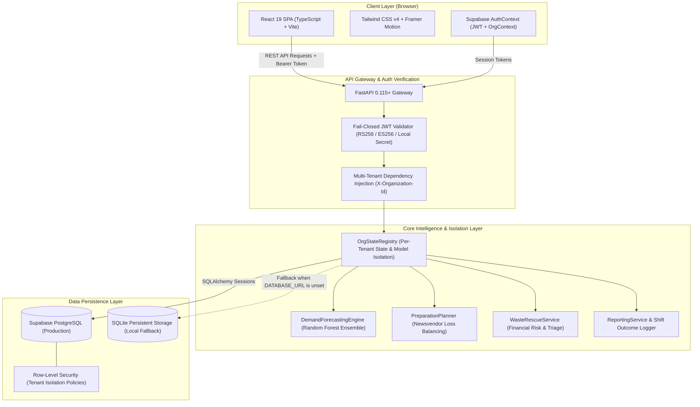

# WasteWise AI — Enterprise Canteen Demand Forecasting & Food Waste Optimization

[](https://github.com/TanishBane/wastewise-ai/actions/workflows/ci.yml)
[](LICENSE)
[](https://www.python.org/)
[](https://fastapi.tiangolo.com/)
[](https://react.dev/)
[](https://www.typescriptlang.org/)
[](https://vite.dev/)
[](https://tailwindcss.com/)
[](https://supabase.com/)
[](https://scikit-learn.org/)
[](tests/)
[](https://oxc.rs/)

> **Predict smarter. Prepare better. Waste less.**
> An enterprise-grade canteen operational intelligence platform combining machine-learning demand forecasting with asymmetric Newsvendor preparation planning, proactive surplus triage, and multi-tenant data isolation with PostgreSQL Row-Level Security (RLS).

---

## Table of Contents

- [Overview](#overview)
- [System Architecture & Workflow](#system-architecture--workflow)
- [Application Screenshot Gallery](#application-screenshot-gallery)
- [Operational Feature Deep Dive](#operational-feature-deep-dive)
  - [1. Calibrated Demand Forecasting](#1-calibrated-demand-forecasting)
  - [2. Economic Preparation Planning (Newsvendor Model)](#2-economic-preparation-planning-newsvendor-model)
  - [3. Proactive Surplus Triage & Rescue](#3-proactive-surplus-triage--rescue)
  - [4. Multi-Tenant Data Isolation & Security](#4-multi-tenant-data-isolation--security)
  - [5. Physical Shift Outcome Auditing](#5-physical-shift-outcome-auditing)
- [Technology Stack Matrix](#technology-stack-matrix)
- [Repository Structure](#repository-structure)
- [Local Installation & Quick Start](#local-installation--quick-start)
- [Environment Variables Specification](#environment-variables-specification)
- [Production Deployment Guides](#production-deployment-guides)
  - [Frontend Deployment (Vercel)](#frontend-deployment-vercel)
  - [Backend Deployment (Render)](#backend-deployment-render)
  - [Database & Auth Deployment (Supabase)](#database--auth-deployment-supabase)
- [Model Evaluation & Data Provenance](#model-evaluation--data-provenance)
- [Testing & Quality Assurance](#testing--quality-assurance)
- [Release Governance & Tagging Criteria](#release-governance--tagging-criteria)
- [Contributing & Security](#contributing--security)
- [License](#license)

---

## Overview

In commercial kitchens, university dining halls, and corporate canteens, food-service managers face an asymmetric daily dilemma:

$$\text{Cook too much} \longrightarrow \text{Ingredients spoil into organic waste, margin erosion, and carbon footprint.}$$
$$\text{Cook too little} \longrightarrow \text{Stockouts, dissatisfied patrons, and lost revenue.}$$

Traditional fixed-batch cooking relies on guesswork and static historical averages, leading to **15–25% avoidable food waste**.

**WasteWise AI** bridges this gap by translating multi-signal operational data into actionable culinary guidance:
1. **Multi-Signal Demand Estimation**: Combines calendar signals (day of week, semester week), event schedules, weather conditions, and historical sales trends via a calibrated Random Forest regressor with 10th–90th percentile prediction intervals.
2. **Asymmetric Newsvendor Preparation Optimization**: Computes risk-adjusted batch targets by mathematically balancing ingredient spoilage costs ($C_o$) against customer stockout penalties ($C_u$) via the critical fractile ratio.
3. **Staggered Two-Phase Batching**: Recommends firing a conservative initial buffer (60–65%) while holding mise-en-place for designated mid-shift refill thresholds.
4. **Proactive Surplus Rescue Protocols**: Identifies at-risk portions hours before shift completion, suggesting discounts, food bank donations, or compost routing based on shelf-life constraints.
5. **Multi-Tenant Security Architecture**: Enforces organizational data isolation using Supabase JWT authentication, PostgreSQL Row-Level Security (RLS), and an in-memory `OrgStateRegistry` service.
6. **Empirical Shift Reconciliation**: Logs physical outcomes (prepared, sold, leftover, waste root cause) into persistent storage to track variance and prevent model drift.

---

## System Architecture & Workflow

### End-to-End System Architecture



### Operational Shift Lifecycle

```mermaid
sequenceDiagram
    autonumber
    actor Mgr as Kitchen Supervisor
    actor Crew as Kitchen Staff
    participant API as WasteWise AI API
    participant ML as Forecasting & Newsvendor Engine
    participant DB as Supabase PostgreSQL / RLS

    Note over Mgr,DB: 06:30 — Morning Planning Cadence
    Mgr->>API: Review Daily Context (Weather, Events, Day of Week)
    API->>ML: Compute Dish Point Forecasts & 80% Uncertainty Bands
    ML-->>API: Expected Demand + Prediction Intervals
    Mgr->>API: Input Ready Inventory & Unit Spoilage/Stockout Costs
    API->>ML: Calculate Critical Fractile (q*) & Staggered Batch 1 Target
    ML-->>API: Batch 1 Target + Mid-Service Refill Threshold
    Mgr->>Crew: Print Clipboard Prep Sheet with Refill Triggers

    Note over Crew,API: 12:30 — Mid-Service Execution
    Crew->>Crew: Cook Batch 1; Monitor Food-Safe Holding (>65°C)
    alt Remaining Stock <= Refill Threshold
        Crew->>Crew: Fire Batch 2 Mise-en-Place
    else Stock Velocity Slow
        Crew->>Crew: Hold Ingredients Raw for Future Service
    end

    Note over Mgr,DB: 13:45 — Surplus Triage & Rescue
    Mgr->>API: Check Surplus Risk Queue
    API->>ML: Evaluate Shelf-Life Expiry & Unsold Inventory
    API-->>Mgr: Priority Rescue Triage (Flash Discount / Food Bank / Compost)

    Note over Mgr,DB: 14:30 — End-of-Shift Reconciliation
    Mgr->>API: Log Actual Shift Outcomes (Prepared, Sold, Leftovers, Waste Cause)
    API->>DB: Persist Outcome Record under Tenant Organization ID
    DB-->>API: Outcome Saved (Audit Invariant: Prepared = Sold + Leftover)
    API-->>Mgr: Reconciliation Complete & Shift Audit Confirmed
```

---

## Application Screenshot Gallery

All screenshots represent verified live renders of the WasteWise AI interface across multiple screen viewports:

| Viewport / Screen | Interface Preview | Key Operational Capabilities |
| :--- | :--- | :--- |
| **Home & Telemetry HUD**<br>`docs/screenshots/home-desktop.png` |  | Desktop landing stage (1440×900) featuring operational value proposition, dynamic HUD telemetry console, daily service cadence, and baseline reference metrics. |
| **Mobile Ergonomics**<br>`docs/screenshots/home-mobile.png` | <p align="center"></p> | Fully responsive mobile viewport (390×844) with single-column layout, zero horizontal overflow (`scrollWidth - clientWidth === 0`), and touch-optimized navigation drawer. |
| **Kitchen Command Center**<br>`docs/screenshots/kitchen-overview.png` |  | Live shift overview displaying key operational indicators: expected demand (161 portions), recommended prep (168 portions), surplus risk (7 portions, ₹887 cost-at-risk), and prioritized decision cards. |
| **Demand Forecasting**<br>`docs/screenshots/demand-forecast.png` |  | Single-dish demand forecasting view with weather/event condition sliders, historical sales scatterplots, and 10th–90th percentile prediction bands. |
| **Preparation Planner**<br>`docs/screenshots/preparation-planner.png` |  | Asymmetric Newsvendor preparation planner with inventory deduction, staggered batch allocation (Batch 1 vs Refill), and printable physical kitchen preparation sheet. |
| **Surplus Rescue Queue**<br>`docs/screenshots/surplus-rescue.png` |  | Proactive surplus triage categorized into High, Moderate, and Low risk tiers, calculating financial risk exposure and dispatching mitigation protocols. |
| **Holdout Model Evaluation**<br>`docs/screenshots/performance-impact.png` |  | Transparent retrospective evaluation on a 280-record chronological holdout set, demonstrating 8.4% WAPE vs 10.8% weekday baseline. |
| **Data Provenance & Upload**<br>`docs/screenshots/data-model.png` |  | Operator dataset management interface showing active record count, data schema validation checklist, provenance disclaimers, and CSV upload dropzone. |

---

## Operational Feature Deep Dive

### 1. Calibrated Demand Forecasting

The forecasting engine utilizes a scikit-learn `RandomForestRegressor` ensemble specifically engineered for food-service demand dynamics:
- **Feature Pipeline**: Integrates cyclic day-of-week encodings, semester academic calendar progress, campus attendance ratios, local weather classifications (Clear, Rainy, Overcast), ambient temperature, and scheduled exam/cultural event indicators.
- **Uncertainty Interval Estimation**: Computes the empirical 10th and 90th percentile prediction intervals across individual trees in the forest ensemble ($n_{\text{estimators}} = 100$). This provides operators with probabilistic bounds rather than an over-confident single point estimate.
- **Dynamic Scenario Simulation**: Kitchen supervisors can test hypothetical operating conditions (e.g. sudden monsoon rainfall or campus festival attendance surges) to preview demand shifts in real time.

### 2. Economic Preparation Planning (Newsvendor Model)

Commercial kitchens suffer from asymmetric losses. Discarded food incurs direct ingredient costs, while running out of a popular meal forfeits revenue and damages customer trust. WasteWise AI formulates preparation targets using classical Newsvendor optimization:

$$\text{Critical Fractile } (CF) = \frac{C_u}{C_u + C_o}$$

Where:
- $C_u$ (**Cost of Underage**): The economic penalty of serving one portion too few (gross margin loss + diner stockout friction penalty).
- $C_o$ (**Cost of Overage**): The direct ingredient cost of producing one portion that spoils unsold.

The optimal target quantity $q^*$ satisfies:

$$P(D \le q^*) = CF$$

- **Inventory-Aware Deduction**: Automatically subtracts pre-existing, food-safe inventory from $q^*$ to determine net production requirements.
- **Staggered Two-Phase Batching**: Automatically breaks the net target into **Batch 1** (initial cook, 60–65%) and **Batch 2** (held mise-en-place), establishing explicit time and stock thresholds for mid-service refill triggers.
- **Printable Kitchen Sheet**: Generates a print-styled physical kitchen preparation sheet complete with batch numbers, refill checkpoints, supervisor sign-offs, and HACCP holding temperature check lines (>65°C hot holding, <5°C cold holding).

### 3. Proactive Surplus Triage & Rescue

Rather than treating leftovers as an inevitable end-of-day loss, the Surplus Rescue engine continuously classifies dish surplus risk into three operational tiers:
- **High Risk**: Discontinue ongoing batch replenishment immediately; apply instant flash discounts or package for immediate campus food-bank pickup.
- **Moderate Risk**: Re-portion into combo offerings or repurpose proteins for evening meal service.
- **Low Risk**: Standard service cadence; demand velocity matches planned portions.

Each recommendation includes calculated financial cost-at-risk based on dish unit production costs.

### 4. Multi-Tenant Data Isolation & Security

WasteWise AI is built with an enterprise multi-tenant security architecture:
- **Supabase PostgreSQL & Row-Level Security (RLS)**: Organizations, members, menu catalogs, forecast runs, preparation plans, and shift outcomes are compartmentalized by `organization_id`. Database RLS policies guarantee that users can never query or manipulate records belonging to another tenant.
- **Fail-Closed JWT Authentication**: Validates incoming bearer tokens using Supabase Auth public keys (RS256 / ES256) or configured signing secrets. Requests missing valid authentication fail closed with HTTP 401.
- **`OrgStateRegistry` Isolation**: The Python backend maintains isolated in-memory model instances, active training sets, and operational parameters per organization, preventing cross-tenant model contamination.
- **Safe Local Development Fallback**: When cloud database environment variables are omitted, the system falls back safely to local persistent SQLite storage using identical SQLAlchemy models.

### 5. Physical Shift Outcome Auditing

To maintain accountability and close the feedback loop for model retraining, kitchen operators record daily shift outcomes:
- **Mathematical Invariant Enforcement**:

  $$\text{Portions Prepared} = \text{Portions Sold} + \text{Portions Leftover}$$

- **Standardized Root-Cause Taxonomy**: Categorizes surplus using structured operational codes:
  - `overproduction` (preparation exceeded actual demand)
  - `spoilage` (ingredient temperature breach or holding failure)
  - `quality_issue` (culinary error or recipe variance)
  - `equipment_failure` (steam table or warmer failure)
- **Model Drift Auditing**: Historical outcomes feed directly into drift detection models, alerting managers when baseline assumptions diverge from physical trends.

---

## Technology Stack Matrix

| Layer | Technologies & Packages | Architectural Purpose |
| :--- | :--- | :--- |
| **Frontend Framework** | [React 19.3](https://react.dev/), [TypeScript 5.9](https://www.typescriptlang.org/) | Single-page application UI with strict typing, concurrent rendering, and clean layer boundaries. |
| **Build & Styling** | [Vite 8.3](https://vite.dev/), [Tailwind CSS v4.3](https://tailwindcss.com/) | Instant HMR development server, tree-shaken production bundles, and CSS custom property token system. |
| **UI Components & Icons** | [Lucide React](https://lucide.dev/), [Framer Motion 14](https://framer.com/motion) | Accessible interface icons and hardware-accelerated animations with `prefers-reduced-motion` fallbacks. |
| **Data Visualization** | [Recharts 3.10](https://recharts.org/) | Responsive SVG charts for demand forecasts, prediction intervals, and historical trends. |
| **Backend API** | [FastAPI 0.115+](https://fastapi.tiangolo.com/), [Uvicorn](https://www.uvicorn.org/) | High-performance asynchronous REST API gateway with automatic OpenAPI documentation. |
| **Machine Learning** | [scikit-learn 1.4+](https://scikit-learn.org/), [pandas 3.0+](https://pandas.pydata.org/), [numpy](https://numpy.org/) | Supervised Random Forest demand forecasting ensemble and feature transformations. |
| **Decision Optimization** | [SciPy 1.18+](https://scipy.org/) | Asymmetric Newsvendor critical fractile optimization and probability distribution fitting. |
| **Database & ORM** | [SQLAlchemy 2.0](https://www.sqlalchemy.org/), [psycopg2](https://www.psycopg.org/) | Abstracted persistence layer supporting PostgreSQL (Supabase) and SQLite with additive migrations. |
| **Authentication & RLS** | [Supabase Auth](https://supabase.com/docs/guides/auth), [PyJWT 2.8+](https://pyjwt.readthedocs.io/) | Multi-tenant organization RBAC, cryptographically verified JWT tokens, and database Row-Level Security. |
| **Monitoring & Telemetry** | [Sentry SDK 2.73+](https://sentry.io/), [PostHog](https://posthog.com/) | Real-time backend and frontend exception tracking, performance tracing, and operational telemetry. |
| **Testing & QA** | [pytest 9.1+](https://docs.pytest.org/), [Oxlint 1.88+](https://oxc.rs/), [Prettier 3.9+](https://prettier.io/) | 46 automated unit/integration tests, Rust-based ultra-fast JavaScript linting, and formatting checks. |

---

## Repository Structure

```text
wastewise-ai/
├── backend/                          # FastAPI application & service architecture
│   ├── auth.py                       # Fail-closed JWT verification & OrgContext resolver
│   ├── database.py                   # SQLAlchemy engine, session factories & schema migrations
│   ├── main.py                       # REST routes, CORS middleware, lifespan & static mounting
│   ├── models.py                     # Multi-tenant SQLAlchemy database models (UUID keys)
│   └── services/                     # Decoupled operational domain services
│       ├── forecasting_service.py    # Random Forest inference & prediction intervals
│       ├── ingestion_service.py      # Operator CSV validation, sanitization & retraining
│       ├── org_state_service.py      # OrgStateRegistry for multi-tenant model isolation
│       ├── planning_service.py       # Newsvendor batch optimization & prep sheet creation
│       ├── reporting_service.py      # Holdout metrics (WAPE/MAE) & impact simulation
│       └── rescue_service.py         # Surplus risk triage & financial exposure tracking
├── data/                             # Data storage & baseline records
│   ├── active_operator_dataset.csv   # Currently active operator dataset
│   ├── wastewise.db                  # Local SQLite database (fallback when DATABASE_URL is unset)
│   └── wastewise_sample_canteen_data.csv # 180-day baseline demonstration dataset
├── docs/                             # Documentation assets
│   ├── screenshots/                  # Verified high-resolution interface screenshots
│   └── deployment-instructions.md    # Multi-platform deployment reference
├── frontend/                         # React 19 TypeScript single-page application
│   ├── public/                       # Favicon, brand marks, and self-hosted fonts
│   ├── src/
│   │   ├── api.ts                    # Strongly typed API client with auth injection
│   │   ├── App.tsx                   # Main layout shell, router & global keyboard listeners
│   │   ├── context/AuthContext.tsx   # Supabase authentication & tenant state provider
│   │   ├── Sidebar.tsx               # Collapsible desktop navigation rail & mobile drawer
│   │   ├── tokens.ts                 # Design token palette and spatial layout constants
│   │   ├── types.ts                  # Shared TypeScript interfaces & API payload schemas
│   │   └── workspace/                # Primary operational view components
│   │       ├── Data.tsx              # Dataset management, schema audit & CSV ingestion
│   │       ├── Home.tsx              # Landing stage, HUD telemetry & operational cadence
│   │       ├── Overview.tsx          # Kitchen Command Center dashboard
│   │       ├── Performance.tsx       # Model holdout evaluation & baseline comparison
│   │       ├── PrintKitchenSheet.tsx # Print-ready physical kitchen prep sheet dialog
│   │       ├── QuickSearchDialog.tsx # Global fuzzy search dialog (Cmd+K / Ctrl+K)
│   │       ├── Rescue.tsx            # Surplus risk triage queue & mitigation routing
│   │       └── Scenario.tsx          # Demand forecasting & batch preparation planner
│   ├── package.json                  # Frontend dependencies and npm scripts
│   ├── vercel.json                   # Vercel SPA routing configuration
│   └── vite.config.ts                # Vite build and development proxy configuration
├── src/                              # Core Python modeling & operations research library
│   ├── config.py                     # Default canteen constants, menu catalogs & parameters
│   ├── data.py                       # Synthetic data generation & CSV schema verification
│   ├── metrics.py                    # WAPE, MAE, and economic impact calculations
│   ├── model.py                      # DemandForecastingEngine (Random Forest Regressor)
│   └── planner.py                    # PreparationPlanner (Newsvendor buffer optimizer)
├── supabase/                         # Supabase configuration & database migrations
│   └── migrations/
│       └── 20261023190000_supabase_auth_multitenant.sql # Production PostgreSQL RLS migration
├── tests/                            # Automated test suite (pytest)
│   ├── test_api.py                   # FastAPI endpoint status & schema contract tests
│   ├── test_auth.py                  # JWT validation, signature verification & RBAC tests
│   ├── test_data.py                  # CSV ingestion, sanitization & retraining tests
│   ├── test_database.py              # Schema migrations & UUID model persistence tests
│   ├── test_metrics.py               # WAPE, MAE & financial exposure calculation tests
│   ├── test_model.py                 # Random Forest training & prediction interval tests
│   ├── test_planner.py               # Newsvendor batch sizing & constraint tests
│   ├── test_tokens.py                # Design token color parity tests
│   └── test_views.py                 # View routing and workspace rendering tests
├── .github/workflows/
│   └── ci.yml                        # GitHub Actions CI matrix (Backend Tests + Frontend Build)
├── render.yaml                       # Render backend deployment configuration
├── requirements.txt                  # Python production and testing dependencies
├── run_website.bat                   # One-click Windows Command Prompt launcher
└── run_website.ps1                   # One-click Windows PowerShell launcher
```

---

## Local Installation & Quick Start

### Prerequisites
- **Python**: Version 3.10, 3.11, 3.12, 3.13, or 3.14.
- **Node.js**: Node.js v20.0+ (Node v22 or v24 recommended) with npm.

### Automated One-Click Launch (Windows)

#### PowerShell:
```powershell
.\run_website.ps1
```

#### Command Prompt (Batch):
```cmd
run_website.bat
```

The script installs missing dependencies, builds the React frontend production bundle, and launches the unified FastAPI server. Open:
👉 **[http://127.0.0.1:8000](http://127.0.0.1:8000)**

---

### Manual Step-by-Step Installation

#### 1. Clone the Repository
```bash
git clone https://github.com/TanishBane/wastewise-ai.git
cd wastewise-ai
```

#### 2. Backend Environment Setup
Create and activate a Python virtual environment:
```bash
# macOS / Linux
python3 -m venv .venv
source .venv/bin/activate

# Windows (PowerShell)
python -m venv .venv
.\.venv\Scripts\Activate.ps1
```

Install backend dependencies:
```bash
pip install -r requirements.txt
```

#### 3. Frontend Compilation
```bash
cd frontend
npm install
npm run build
cd ..
```

#### 4. Start the Application
```bash
python -m uvicorn backend.main:app --host 127.0.0.1 --port 8000
```
FastAPI serves the compiled React single-page application and all `/api` endpoints on port `8000`.

---

### Active Development Mode (Hot Module Replacement)

For live code editing with real-time reload:
1. Start the FastAPI backend on port 8000:
   ```bash
   python -m uvicorn backend.main:app --host 127.0.0.1 --port 8000 --reload
   ```
2. In a separate terminal, start the Vite development server:
   ```bash
   cd frontend
   npm run dev
   ```
3. Open `http://localhost:3000`. Vite automatically proxies `/api` calls to the FastAPI backend at `http://127.0.0.1:8000`.

---

## Environment Variables Specification

WasteWise AI is configured through environment variables. For local evaluation, all variables have secure, sensible defaults:

| Variable | Component | Required in Prod? | Default (Local Dev) | Description |
| :--- | :--- | :--- | :--- | :--- |
| `DATABASE_URL` | Backend | **Yes** (Supabase) | *Unset* (falls back to SQLite) | PostgreSQL connection string (`postgresql://postgres:[PASSWORD]@[HOST]:5432/postgres`). |
| `SUPABASE_URL` | Backend | **Yes** (Supabase) | *Unset* | Project URL for Supabase Auth and REST API. |
| `SUPABASE_SERVICE_ROLE_KEY` | Backend | **Yes** (Supabase) | *Unset* | Service role key for trusted administrative queries and provisioning. |
| `SUPABASE_JWT_SECRET` | Backend | **Yes** (Supabase) | *Unset* | Secret used to verify HS256/RS256 JWT bearer tokens fail-closed. |
| `WASTEWISE_CORS_ORIGINS` | Backend | **Yes** (Production) | `http://127.0.0.1:3000,http://localhost:3000` | Comma-separated allowed CORS origins (e.g. `https://wastewise-ai.vercel.app`). |
| `WASTEWISE_DB_PATH` | Backend | No | `data/wastewise.db` | Local SQLite database file path when `DATABASE_URL` is not provided. |
| `SENTRY_DSN` | Backend | No | *Unset* | Sentry project DSN for backend exception and performance tracking. |
| `PORT` | Backend | No | `8000` | Port for the Uvicorn ASGI server. |
| `VITE_API_BASE_URL` | Frontend | **Yes** (Vercel) | `""` (relative `/api`) | Public URL of the FastAPI backend (e.g. `https://wastewise-api.onrender.com`). |
| `VITE_SUPABASE_URL` | Frontend | **Yes** (Supabase) | *Unset* | Public Supabase project URL for browser auth initialization. |
| `VITE_SUPABASE_PUBLISHABLE_KEY` | Frontend | **Yes** (Supabase) | *Unset* | Public anonymous API key (`anon` key) for Supabase client. |
| `VITE_SENTRY_DSN` | Frontend | No | *Unset* | Sentry DSN for React client error monitoring. |
| `VITE_POSTHOG_KEY` | Frontend | No | *Unset* | PostHog API key for front-end analytics and telemetry. |

---

## Production Deployment Guides

### Frontend Deployment (Vercel)

The React frontend is designed for seamless deployment to Vercel as a single-page application.

#### Option A — Via Vercel Dashboard
1. Log in to [Vercel](https://vercel.com/) and click **Add New... > Project**.
2. Import the `TanishBane/wastewise-ai` repository.
3. Configure Project Settings:
   - **Framework Preset**: `Vite`
   - **Root Directory**: `frontend`
   - **Build Command**: `npm run build`
   - **Output Directory**: `dist`
   - **Install Command**: `npm install`
4. Add Environment Variables:
   - `VITE_API_BASE_URL`: `https://wastewise-api.onrender.com` (your deployed backend URL)
   - `VITE_SUPABASE_URL`: `https://[PROJECT-REF].supabase.co`
   - `VITE_SUPABASE_PUBLISHABLE_KEY`: `[ANON-KEY]`
5. Click **Deploy**. The `frontend/vercel.json` rewrite configuration automatically ensures full client-side route hydration without 404 errors on page refresh.

#### Option B — Via Vercel CLI
```bash
cd frontend
vercel --prod
```

---

### Backend Deployment (Render)

The FastAPI backend is pre-configured for Render deployment via `render.yaml`.

1. Log in to [Render](https://render.com/) and navigate to **Blueprints**.
2. Connect the `TanishBane/wastewise-ai` repository.
3. Render reads `render.yaml` and provisions:
   - **Service Name**: `wastewise-api`
   - **Environment**: Python 3.12
   - **Build Command**: `pip install -r requirements.txt`
   - **Start Command**: `uvicorn backend.main:app --host 0.0.0.0 --port $PORT`
4. In the Render Dashboard, add your environment variables under **Environment**:
   - `DATABASE_URL`: Your Supabase PostgreSQL pooling connection string.
   - `SUPABASE_URL`: Your Supabase project URL.
   - `SUPABASE_JWT_SECRET`: Your Supabase JWT secret.
   - `WASTEWISE_CORS_ORIGINS`: `https://wastewise-ai.vercel.app` (your Vercel frontend URL).

---

### Database & Auth Deployment (Supabase)

1. Create a project on [Supabase](https://supabase.com/).
2. Open the **SQL Editor** in the Supabase Dashboard.
3. Open `supabase/migrations/20261023190000_supabase_auth_multitenant.sql` and run the script. This migration creates:
   - `organizations` and `organization_members` tables with RBAC roles (`owner`, `admin`, `operator`).
   - Tenant-isolated tables: `menu_items`, `forecast_runs`, `preparation_plans`, `actual_outcomes`, `upload_history`.
   - Comprehensive **Row-Level Security (RLS)** policies restricting read, insert, update, and delete access strictly to authenticated members of the specified organization.
   - Secure trigger and stored functions for auto-provisioning onboarding user organizations.
4. Copy the connection string from **Project Settings > Database > Connection Pooling (Transaction Mode)** and assign it to `DATABASE_URL` in your backend environment.

---

## Model Evaluation & Data Provenance

To uphold scientific and operational integrity, WasteWise AI maintains strict data provenance disclosures:

### Benchmark Evaluation (Holdout Split)
Model accuracy is evaluated on an unseen 280-record chronological holdout dataset starting 24 August 2026:

- **Weighted Absolute Percentage Error (WAPE)**:

  $$\text{WAPE} = \frac{\sum_{i=1}^{n} |y_i - \hat{y}_i|}{\sum_{i=1}^{n} y_i}$$

  - **WasteWise AI Random Forest**: **8.4% WAPE**
  - **Historical Weekday Baseline**: **10.8% WAPE**
  - **Improvement**: 2.4 percentage points reduction in portion error.

- **Mean Absolute Error (MAE)**:

  $$\text{MAE} = 4.8 \text{ portions per dish}$$

### Data Integrity & Provenance Transparency
- **Demonstration vs Production Data**: The baseline 180-day operational dataset (`data/wastewise_sample_canteen_data.csv`) is synthetically generated using calibrated Gaussian noise, academic calendar schedules, and realistic weather patterns.
- **Visual Status Badges**: The user interface visibly distinguishes between **Synthetic Demonstration Data** and **Live Operator Records** across the header status bar and dataset management views.
- **Operator Retraining**: When an operator uploads historical service CSVs via the Data Management screen, the system validates schema constraints, checks date continuity, and retrains the model specifically for that organization.

---

## Testing & Quality Assurance

WasteWise AI enforces a comprehensive automated testing discipline across the entire stack:

### 1. Backend Automated Test Suite (Pytest)
Run the 46 automated backend tests covering API contracts, multi-tenant authentication, database migrations, Newsvendor economics, and model intervals:
```bash
python -m pytest
```
*Current Status: 46 / 46 passing tests.*

Test suite coverage includes:
- `tests/test_api.py`: FastAPI endpoint statuses, request validation, and OpenAPI schema compliance.
- `tests/test_auth.py`: JWT signature validation, algorithm mismatch rejection, fail-closed authentication, and tenant authorization.
- `tests/test_database.py`: SQLAlchemy multi-tenant schema migrations, UUID primary key generation, and query scoping.
- `tests/test_data.py`: CSV schema validation, sanitization of missing rows, and organization-scoped retraining.
- `tests/test_planner.py`: Asymmetric Newsvendor critical fractile calculations, inventory deductions, and batch constraints.
- `tests/test_model.py`: Random Forest fitting, point predictions, and 10th–90th uncertainty intervals.
- `tests/test_metrics.py`: WAPE, MAE, and cost-at-risk financial calculations.
- `tests/test_tokens.py`: Parity checks between Tailwind CSS classes and design system tokens.
- `tests/test_views.py`: Route navigation and workspace layout contracts.

### 2. Frontend Compilation & Type Verification
```bash
cd frontend
npm run build
```
*Current Status: Compiles cleanly with TypeScript strict mode enabled in <12 seconds.*

### 3. Code Hygiene & Linting
```bash
npm run lint --prefix frontend
npm run format:check --prefix frontend
```
*Current Status: 0 errors reported across all 29 TypeScript/TSX source modules.*

---

## Release Governance & Tagging Criteria

WasteWise AI follows Semantic Versioning (`MAJOR.MINOR.PATCH`).

### Release Readiness Checklist
Before tagging and publishing an official production release (e.g. `v0.1.0` or `v1.0.0`):
- [x] All 46 backend pytest tests passing cleanly on `main`.
- [x] Frontend TypeScript compilation and Vite production build succeeding with zero errors.
- [x] Code style and linting verified with zero errors.
- [x] Supabase multi-tenant schema migrations validated with strict RLS policies.
- [x] Fail-closed authentication verified with signature enforcement.
- [ ] Vercel frontend deployed and accessible with live domain.
- [ ] Render backend deployed and passing live `/api/health` probes.
- [ ] Supabase production project connected with production connection string.

### How to Create an Official Release Tag
Once live cloud deployments are active and verified by the repository owner:
```bash
# 1. Ensure you are on the main branch with latest commits
git checkout main
git pull origin main

# 2. Create an annotated git tag
git tag -a v0.1.0 -m "WasteWise AI v0.1.0 — Initial Multi-Tenant Production Release"

# 3. Push the tag to GitHub
git push origin v0.1.0
```

---

## Contributing & Security

### Security Policy
If you discover a security vulnerability in WasteWise AI, please report it privately via GitHub Security Advisories or contact the maintainer directly. **Do not disclose security vulnerabilities publicly in open issues.**

### Contributing
1. Fork the repository and create a feature branch (`git checkout -b feature/amazing-feature`).
2. Verify all tests pass locally (`pytest` and `npm run build`).
3. Commit your changes with clear, descriptive commit messages.
4. Push to your branch and open a Pull Request against `main`.

---

## License

WasteWise AI is licensed under the **MIT License**.
See the [LICENSE](LICENSE) file for complete details.

Copyright (c) 2026 Tanish Bane.
